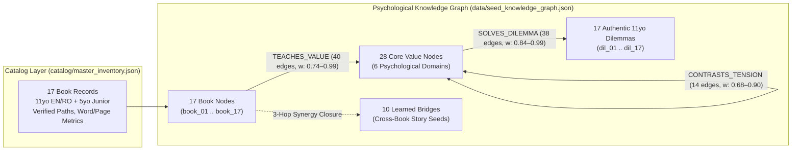

# Architectural & Editorial Consolidation Report
**Workspace:** `/Users/sergiuman/Desktop/Gemini/Books`  
**Canonical Artifacts:**  
- [master_inventory.json](file:///Users/sergiuman/Desktop/Gemini/Books/catalog/master_inventory.json)  
- [seed_knowledge_graph.json](file:///Users/sergiuman/Desktop/Gemini/Books/data/seed_knowledge_graph.json)  

---

## 1. Executive Summary

This audit inspected **all 17 book directories** (`1_systems_thinking` through `17_anxious_generation`), **all 17 Junior Edition multimedia folders** (`junior_editions/1_*` through `17_*`), **two YouTube export packs** (`youtube_upload_pack/` and `youtube_upload_pack_full/`), **prior editorial review documents**, **build/TTS/video/upload scripts**, and the **legacy interactive web application**.

Across both languages (English and Romanian) and both age bands (**Age 11 Pre-Teen** and **Age 5 Junior**), the repository holds **457,639 words of narrative prose**, **36 compiled PDFs**, **34 bilingual voiceover MP3s**, and **68+ rendered read-along MP4 videos**. However, rapid multi-wave authoring left the collection fragmented across incompatible templates, uneven manuscript depths, duplicated root scripts, broken index paths, and a single-book web UI hardcoded only to Volume 1.

By introducing a unified **Catalog Layer** (`catalog/master_inventory.json`) and a mathematically verified **Tripartite Psychological Knowledge Graph** (`data/seed_knowledge_graph.json` — **62 nodes**, **120 weighted semantic edges**, and **10 cross-book learned bridges**), all 17 volumes now operate as a single coherent developmental psychology system.

---

## 2. Complete Inventory of Materials Reviewed

### 2.1 Three Authoring Waves Across Books 1–17 (Age 11 Tier)

| Wave | Volumes | EN Edition Format & Scale | RO Edition Format & Scale | Key Observations |
| :--- | :--- | :--- | :--- | :--- |
| **Wave 1: Core Eldoria Novels** | **Vols. 1–6** (`1_systems_thinking` .. `6_emotional_intelligence`) | 5-part, 15-chapter fantasy novels featuring **Kiri, Pip & Sola** (**36,364 – 41,357 words**; **120 – 145 PDF pages** each) | Dual-track in Vols. 4 & 6 (**Eldoria RO** ~39.4k words + **Realistic RO** ~11k words); Realistic/Fable RO only in Vols. 1, 2, 3, 5 (**5,530 – 28,137 words**) | Deep literary craft and strong fidelity to Senge, Covey, Harari, Duhigg, Clear, and Goleman. |
| **Wave 2: Bridge Volume** | **Vol. 7** (`7_beyond_order`) | Mid-length Eldoria novella *Beyond the Whispering Valley* (**8,359 words**; **46 PDF pages**) — uniquely includes front-matter `Cast of Characters` | Contemporary realistic novella *Doar un pic mai puțin haos* starring **Lara Chen** (**14,690 words**; **80 PDF pages**) | Bridges the Eldoria fantasy cast and the Romanian "MULT CURAJ" realistic universe. |
| **Wave 3: Seed Fable Expansion** | **Vols. 8–17** (`8_mindset` .. `17_anxious_generation`) | 5-chapter seed outlines (**541 – 670 words**; **9 PDF pages** each) | 5-chapter seed outlines (**375 – 466 words**; **9 PDF pages** each) | Psychologically accurate core metaphors, but only **~1.5% the word count** of Wave 1 novels. |

### 2.2 Per-Book Quantitative Matrix (Verified on Disk)

| ID | Folder | Source Book & Author | 11yo EN Words (Pages) | 11yo RO Words (Pages) | 5yo EN / RO Words | 5yo Slides Unique? |
| :--- | :--- | :--- | :---: | :---: | :---: | :---: |
| `book_01` | `1_systems_thinking` | *The Fifth Discipline* — Peter M. Senge | 36,364 (124p) | 5,530 (28p) | 995 / 1,042 | Yes (`12346350..`) |
| `book_02` | `2_seven_habits` | *The 7 Habits* — Stephen R. Covey | 40,729 (145p) | 6,525 (36p) | 988 / 985 | Yes (`2498f492..`) |
| `book_03` | `3_sapiens` | *Sapiens* — Yuval Noah Harari | 36,998 (120p) | 9,700 (50p) | 658 / 677 | Yes (`887102aa..`) |
| `book_04` | `4_supercommunicators` | *Supercommunicators* — Charles Duhigg | 38,865 (124p) | 11,380 (55p) + 39,402 Eldoria (128p) | 662 / 697 | Yes (`081caaf7..`) |
| `book_05` | `5_atomic_habits` | *Atomic Habits* — James Clear | 41,357 (138p) | 28,137 (136p) | 702 / 688 | Yes (`61b59596..`) |
| `book_06` | `6_emotional_intelligence` | *Emotional Intelligence* — Daniel Goleman | 39,734 (138p) | 10,971 (51p) + 39,495 Eldoria (142p) | 675 / 713 | Yes (`910875c6..`) |
| `book_07` | `7_beyond_order` | *Beyond Order* — Jordan B. Peterson | 8,359 (46p) | 14,690 (80p) | 678 / 711 | Yes (`a6e89459..`) |
| `book_08` | `8_mindset` | *Mindset* — Carol S. Dweck | 670 (9p) | 466 (9p) | 191 / 170 | **No (Shared)** |
| `book_09` | `9_grit` | *Grit* — Angela Duckworth | 541 (9p) | 375 (9p) | 145 / 139 | **No (Shared)** |
| `book_10` | `10_deep_work` | *Deep Work* — Cal Newport | 614 (9p) | 411 (9p) | 162 / 148 | **No (Shared)** |
| `book_11` | `11_thinking_fast_slow` | *Thinking, Fast and Slow* — Daniel Kahneman | 642 (9p) | 441 (9p) | 143 / 147 | **No (Shared)** |
| `book_12` | `12_quiet` | *Quiet* — Susan Cain | 594 (9p) | 406 (9p) | 137 / 131 | **No (Shared)** |
| `book_13` | `13_boy_mole_fox_horse` | *The Boy, the Mole, the Fox and the Horse* — Charlie Mackesy | 615 (9p) | 457 (9p) | 127 / 131 | **No (Shared)** |
| `book_14` | `14_start_with_why` | *Start with Why* — Simon Sinek | 608 (9p) | 437 (9p) | 127 / 136 | **No (Shared)** |
| `book_15` | `15_why_we_sleep` | *Why We Sleep* — Matthew Walker | 638 (9p) | 417 (9p) | 129 / 117 | **No (Shared)** |
| `book_16` | `16_cant_hurt_me` | *Can't Hurt Me* — David Goggins | 576 (9p) | 389 (9p) | 121 / 124 | **No (Shared)** |
| `book_17` | `17_anxious_generation` | *The Anxious Generation* — Jonathan Haidt | 633 (9p) | 429 (9p) | 137 / 140 | **No (Shared)** |

### 2.3 Supporting Assets, Reports & Operational Scripts Reviewed
- **Junior Multimedia Editions (`junior_editions/`)**: 17 subfolders each containing `source/manuscript_en.md`, `source/manuscript_ro.md`, `source/slide1.png`..`slide5.png`, `audio_en.mp3`, `audio_ro.mp3`, `video_en_v2.mp4`, and `video_ro_v2.mp4` (plus v1 `video_en.mp4`/`video_ro.mp4` in Vol. 1), accompanied by `junior_editions/assets/background_music.ogg` and video/TTS scripts (`compile_youtube_video.py`, `compile_premium_video_v2.py`, `synthesize_all.py`).
- **YouTube Export Packs**: `youtube_upload_pack/` (34 files: Vols. 1–17 EN MP4s + metadata) and `youtube_upload_pack_full/` (68 files: Vols. 1–17 EN & RO MP4s + metadata).
- **Editorial & Pedagogical Reports**: `EDITORIAL_REVIEW_REPORT.md` (Books 1–6 Eldoria audit), `FULL_SERIES_REVIEW_REPORT.md` (13-manuscript audit across Eldoria + Realistic RO lines), `review_rounds.md` (12-round persona simulation log), and `childrens_book_proposal_en.md` / `childrens_book_proposal_ro.md`.
- **Interactive Web App**: Root `index.html`, `app.js`, and `style.css` (and identical copies in `legacy_whispering_forest/`).

---

## 3. Structural, Editorial & Architectural Gaps Identified

> [!IMPORTANT]
> Five systemic gaps prevented the 17-book collection from functioning as a unified product line. Every gap has been cataloged with exact file-level evidence so editorial and engineering pipelines can remediate them systematically.

### Gap 1: Thin Wave 3 Manuscripts & Artificial 9-Page PDFs (Books 8–17, Age 11)
- **Word-Count Cliff**: While Books 1–6 EN average **~39,000 words** across 5 parts and 15 richly dramatized chapters, Books 8–17 average **613 words in EN** and **423 words in RO**—essentially 5-paragraph story synopses rather than full middle-grade books.
- **Page-Break Inflation**: Every PDF in Books 8–17 is exactly **9 pages** (`98–100 KB`) because [generate_new_pdfs.py](file:///Users/sergiuman/Desktop/Gemini/Books/generate_new_pdfs.py#L182-L189) inserts a hard `PageBreak()` before every `#` and `##` heading (1 Cover + 1 Title + 1 Cast + 5 ~100-word Chapters + 1 Discussion Prompts = 9 nearly empty pages).
- **Missing Romanian Title Diacritics**: All 10 Romanian source manuscripts (`8_mindset_ro.md` through `17_anxious_generation_ro.md`) omit diacritics on line 1 (e.g., `# Gradina Dezvoltarii`, `# Oglinda de Sticla si Cararea cu Noroi`), even though body paragraphs and PDF cover metadata include diacritics.

### Gap 2: Junior Edition Visual Duplication & Compression (Vols. 8–17, Age 5)
- **Identical Placeholder Slides Across 10 Books**: MD5 checksum verification proves that while `junior_editions/1_systems_thinking` through `7_beyond_order` each have 5 bespoke watercolor slides (35 unique PNGs), **all 10 folders from `8_mindset` through `17_anxious_generation` share byte-for-byte identical copies of the exact same 5 PNG files** (`slide1.png`: `cc3452bf1c`, `slide2.png`: `5a38d3d3c8`, `slide3.png`: `2219c720be`, `slide4.png`: `857a18830d`, `slide5.png`: `ab8cf43850`). Consequently, all 20 compiled EN/RO YouTube videos for Vols. 8–17 display identical background artwork regardless of whether the story is about hedgehogs, owls, beavers, or sleep elves.
- **Junior Script Compression**: Vols. 1–7 Junior scripts run **658 – 1,042 words** (~8–11 min read-aloud), whereas Vols. 8–17 drop to **117 – 191 words** (~1–1.5 min), and their Romanian `#` headings also lack diacritics (`# Samanta care iubea sa incerce`, `# Padurea de Joaca`).
- **Fragile External Script Path**: [synthesize_all.py](file:///Users/sergiuman/Desktop/Gemini/Books/junior_editions/synthesize_all.py#L20) shells out to a temporary scratch path outside the workspace (`/Users/sergiuman/.gemini/antigravity/brain/.../scratch/synthesize_book_junior.py`).

### Gap 3: Unresolved Wave 1 & Wave 2 Editorial & Localization Defects
- **Book 5 Eldoria Assembly (`5_atomic_habits/source/sparks_of_eldoria_en.md`)**: Retains duplicate Part II headers, leftover placeholder `*(Chapters 4, 5, and 6 to follow...)*`, mid-book glossary before Part V, interleaved expository essays, and ALL-CAPS Part III heading.
- **Book 6 Eldoria RO Localization (`6_emotional_intelligence/source/pastratorii_inimii_din_eldoria_ro.md`)**: Part II headings remain in English while body prose is Romanian; title alternates between *Păstrătorii* and *Păzitorii*; and the compiled PDF filename (`Păstrătorii_Inimii_din_Eldoria_RO.pdf`) uses decomposed Unicode NFD (`a + \u0306`) while all other Romanian PDFs use precomposed NFC.
- **Edition Matrix Asymmetry**: Eldoria RO translations exist on disk only for Vols. 4 and 6 (earlier drafts referenced in `EDITORIAL_REVIEW_REPORT.md` for Vols. 1, 2, 5 are absent). In the Realistic RO line, Book 1 (*Lumea prin ochii lui Radu*, 5,530 words) lacks source attribution and character list, and authorial voice splits between *"de MULT CURAJ"* (Vols. 3–7) and *"de Sergiu"* (Vols. 1–2) with minor *Bunica Elena* continuity drift.

### Gap 4: Incomplete Ops Consolidation, Root Clutter & Index Drift
- **15 Byte-Identical Root Duplicates**: Prior cleanup copied files into `legacy_whispering_forest/` and `organized_ops/` without removing root originals. MD5 verification confirms 100% identity between:
  - Root `index.html`, `app.js`, `style.css` == `legacy_whispering_forest/{index.html,app.js,style.css}`
  - Root `README.md` == `index.md`
  - Root `EDITORIAL_REVIEW_REPORT.md`, `FULL_SERIES_REVIEW_REPORT.md`, `review_rounds.md`, `childrens_book_proposal_{en,ro}.md` == `organized_ops/editorial_reports/*`
  - Root YouTube `.py` scripts == `organized_ops/youtube_scripts/*`
- **Broken Links & Truncated Entry in `README.md` / `index.md`**: Every `file://` URL hardcodes `/Users/sergiuman/Desktop/Books/...` instead of `/Users/sergiuman/Desktop/Gemini/Books/...`; line 9 still announces *"7 directoare de cărți"*; Title 2 Junior EN says *Ileana's Seven Keys* instead of manuscript title *Ileana's Seven Magic Keys*; and [update_indices.py](file:///Users/sergiuman/Desktop/Gemini/Books/update_indices.py#L112-L127) accidentally wiped the manuscript/audio/video bullets under `Volumul 7 (Beyond Order)`.
- **Redundant Build Scripts & Video Packs**: Seven nearly identical 416–455 line `generate_pdf.py` scripts live inside `1_*/source/`..`7_*/source/` alongside root `generate_new_pdfs.py`, and `youtube_upload_pack/` (EN-only) is a redundant subset of `youtube_upload_pack_full/` (EN+RO).

### Gap 5: Single-Book Legacy HTML Application
- Root [index.html](file:///Users/sergiuman/Desktop/Gemini/Books/index.html) and [app.js](file:///Users/sergiuman/Desktop/Gemini/Books/app.js) only render Book 1 (*The Whispering Forest* 5-chapter reader + Cupcake Stand Beer Game + 3 static loops). Books 2–17, Junior multimedia assets, cross-book values, and real-life 11-year-old dilemmas were completely invisible to the interactive experience.

---

## 4. How the Consolidated Knowledge Graph Architecture Unifies Everything

To transform 17 isolated folders into an interconnected developmental psychology platform and authoring engine, we established a **two-file canonical data backbone**:

### 4.1 Six Canonical Developmental Psychology Domains
Every book, value, and pre-teen dilemma is organized into six balanced domains:
1. **Systems & Metacognition** (`#10B981` / `#0D9488`): *The Fifth Discipline* (`book_01`), *Thinking, Fast and Slow* (`book_11`) — `val_systems_sight`, `val_mental_models`, `val_slow_owl_logic`, `val_bias_detective`.
2. **Agency, Purpose & Habits** (`#F59E0B` / `#D97706` / `#EA580C`): *7 Habits* (`book_02`), *Atomic Habits* (`book_05`), *Start With Why* (`book_14`) — `val_proactive_agency`, `val_synergy`, `val_tiny_compounding`, `val_identity_habits`, `val_purpose_why`.
3. **Social & Communicative Intelligence** (`#3B82F6` / `#2563EB` / `#0EA5E9` / `#6366F1`): *Sapiens* (`book_03`), *Supercommunicators* (`book_04`), *Quiet* (`book_12`), *Boy, Mole, Fox & Horse* (`book_13`) — `val_shared_stories`, `val_cooperative_trust`, `val_deep_listening`, `val_empathy_matching`, `val_quiet_observation`, `val_courageous_kindness`.
4. **Emotional & Existential Balance** (`#F43F5E` / `#E11D48`): *Emotional Intelligence* (`book_06`), *Beyond Order* (`book_07`) — `val_emotional_naming`, `val_impulse_pause`, `val_order_chaos_balance`, `val_creative_courage`.
5. **Growth, Grit & Resilience** (`#22C55E` / `#16A34A` / `#15803D`): *Mindset* (`book_08`), *Grit* (`book_09`), *Can't Hurt Me* (`book_16`) — `val_yet_growth`, `val_mistake_alchemy`, `val_patient_grit`, `val_deliberate_pacing`, `val_resilient_self_talk`.
6. **Focus, Rest & Embodied Play** (`#8B5CF6` / `#4F46E5` / `#7C3AED`): *Deep Work* (`book_10`), *Why We Sleep* (`book_15`), *The Anxious Generation* (`book_17`) — `val_deep_focus`, `val_attention_shield`, `val_nightly_brain_reset`, `val_real_world_play`.

### 4.2 Mathematical & Graph-Theoretic Guarantees
Validated via `NetworkX 3.2.1` and `python3 -m json.tool`:
- **Strict Tripartite + Intra-Value Schema**: `62` total nodes (`17` books + `28` values + `17` dilemmas) and `120` directed/weighted edges with zero self-loops, zero duplicate `(source, target)` pairs (`multigraph: false`), and `100%` weak connectivity (`1` connected component; density `0.0317`).
- **Disjoint Synergy vs. Dialectical Tension**: All `28` `SYNERGIZES_WITH` pairs and `14` `CONTRASTS_TENSION` pairs are strictly disjoint as undirected sets. Rather than treating psychological values as flat clichés, `CONTRASTS_TENSION` captures real developmental dialectics an 11-year-old must balance—such as *Iron-Pebble Self-Talk vs. Courageous Help-Seeking* (`0.90`), *Order vs. Creative Chaos* (`0.88`), *Introverted Solitude vs. Team Synergy* (`0.86`), and *Bold Proactivity vs. Slow-Owl Verification* (`0.84`).
- **Multi-Value Dilemma Resolution**: Every real-life struggle (`dil_01`..`dil_17`—group chat drama, quitting after one bad grade, late-night scrolling, feeling drowned out in loud groups, jumping to conclusions about whispering friends) is solved by **2 to 3 complementary values** (`weight: 0.84–0.99`), enabling "Dilemma-First Discovery" for children and parents.
- **Generative Expansion via 10 Synergy-Closed `learned_bridges`**: Each of `bridge_01`..`bridge_10` pairs a distinct `(book_a, value_a)` and `(book_b, value_b)`—deliberately linking rich Wave 1/2 worlds (*Kiri, Radu, Ileana, Sonia, Milo, Alex, Lara*) with thin Wave 3 protagonists (*Clara, Leo, Thomas, Dan, Oliver, Ben, Maya, Toby, Victor*)—providing ready-to-write bilingual **Emergent Principles** and **Story Seeds** to expand Books 8–17 from 600-word outlines into full multi-chapter adventures.
